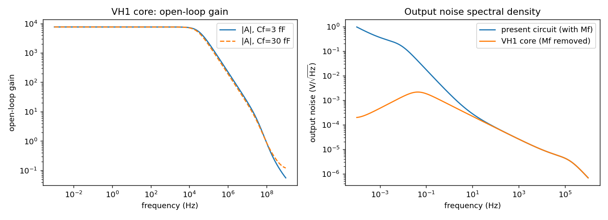
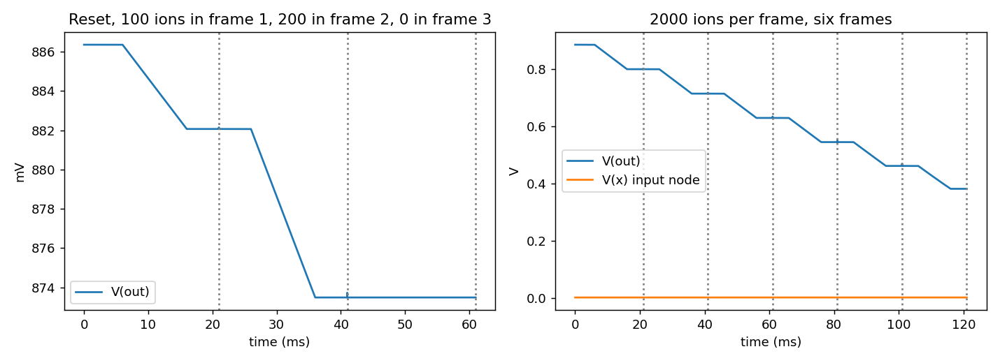

# VH1 reset CSA prototype: results

Core: csa_v3 amplifier (M1-M6, biases, Cd = 1.25 pF), Mf removed; model `8a9ae4754448`.

## Open-loop response (A = -V(out)/V(in), closed loop with Cf)

| Cf | A0 | pole (Hz) | unity-gain (Hz) | GBP (Hz) | closed-loop bandwidth (Hz) |
|---|---|---|---|---|---|
| 3f | 7605 | 2.97e+04 | 9.36e+07 | 2.26e+08 | 9.04e+04 |
| 30f | 7605 | 2.55e+04 | 9.33e+07 | 1.94e+08 | 1.14e+06 |

Input impedance minimum between 1 kHz and 100 MHz (Cf = 3 fF): 689 ohm.

## Transients (output read 50 us before each frame end)

| run | Vref (V) | frame-end V(out) | drop from Vref (mV) | expected accumulated ions | uV per ion |
|---|---|---|---|---|---|
| swap_vref0886_voff0 | 0.886 | 0.8821, 0.8735, 0.8735 | 4.293, 12.876, 12.876 | 100, 300, 300 | 42.93, 42.92, 42.92 |
| swap_vref0886_voff50mV | 0.886 | 0.8821, 0.8735, 0.8735 | 4.293, 12.876, 12.876 | 100, 300, 300 | 42.93, 42.92, 42.92 |
| swap_vref1000_voff0 | 1.000 | 0.9735, 0.9649, 0.9649 | 26.475, 35.080, 35.081 | 100, 300, 300 | 264.75, 116.93, 116.94 |
| swap_packet100 | 0.886 | 0.8823, 0.8821, 0.8821 | 4.080, 4.286, 4.286 | 100, 100, 100 | 40.80, 42.86, 42.86 |
| swap_range2000 | 0.886 | 0.8006, 0.7151, 0.6300, 0.5454, 0.4620, 0.3818 | 85.748, 171.239, 256.381, 340.961, 424.379, 504.526 | 2000, 4000, 6000, 8000, 10000, 12000 | 42.87, 42.81, 42.73, 42.62, 42.44, 42.04 |

Ideal gain e/Cf = 53.41 uV per ion; measured 42.93 uV per ion (fraction 0.804; AC transimpedance at 1 Hz gives 0.803).
Input capacitance seen at the gate: amplifier alone 4.34 pF, with the 1.25 pF pad 5.58 pF; predicted charge fraction (1+A)Cf/[C_in+(1+A)Cf] = 0.803.

## ENC (ions RMS, 20 ms frames)

| weighting | VH1 | present circuit |
|---|---|---|
| frame difference of point samples | 109.0 | 119.6 |
| frame difference of 5 ms averages | 40.2 | 50.2 |
| frame difference of 20 ms averages | 27.5 | 36.7 |
| present calibrated estimator (point samples, alpha) | nan | 90.0 |

VH1 uses the measured gain per ion of the first test frame; the present circuit uses its calibrated 40.16 uV per ion.

